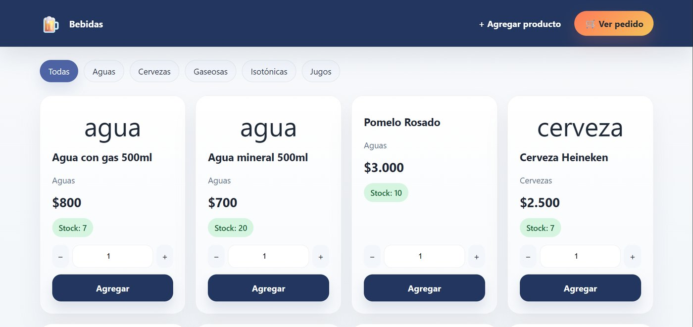
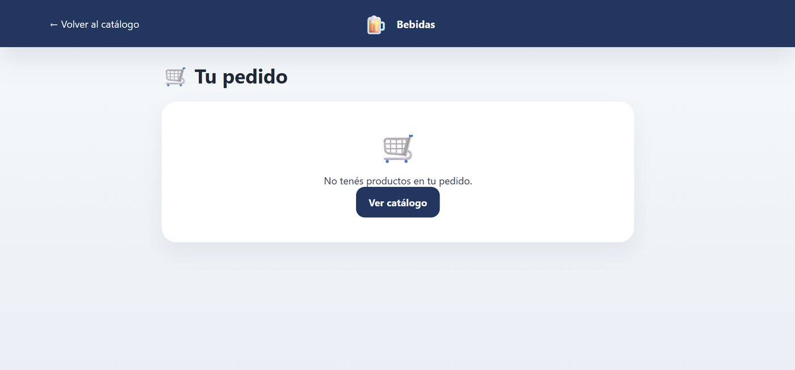
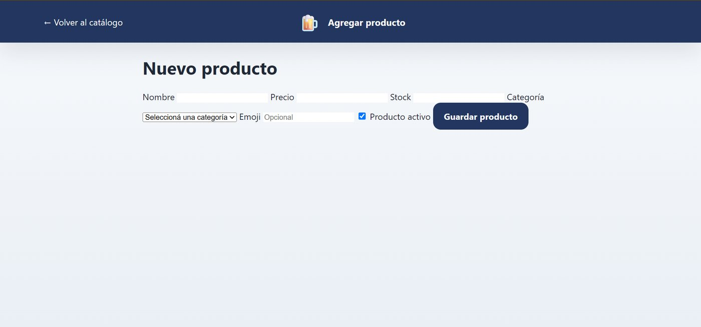
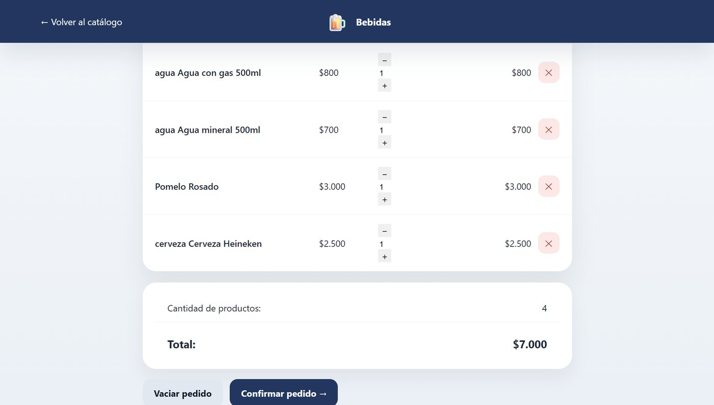

# Sistema de Stock y Ventas de Bebidas

Sistema web para que un local de bebidas controle su stock y registre pedidos. Desarrollado como proyecto final de la materia Modelado de Software.



## Funcionalidades

- **Catálogo** con filtro por categoría (aguas, cervezas, gaseosas, isotónicas y jugos) y stock visible.
- **Carrito de pedidos** guardado en la sesión, con cantidades editables, subtotales y total calculado automáticamente.
- **Control de stock**: no se puede pedir más de lo disponible; al confirmar se vuelve a verificar el stock y el precio dentro de una transacción, así un pedido se guarda completo o no se guarda.
- **Confirmación de pedidos**: se registra el pedido con su detalle y se descuenta el stock.
- **Alta de productos** con precio, stock, categoría y estado activo o inactivo, con validación de datos.
- **Resumen** de cada pedido confirmado.

## Tecnologías

- PHP (sin frameworks), con `mysqli` y consultas preparadas
- MySQL
- HTML5 y CSS3

## Capturas

| Carrito | Alta de producto | Pedidos |
|---|---|---|
|  |  |  |

## Cómo ejecutarlo

1. Instalar [XAMPP](https://www.apachefriends.org/) e iniciar **Apache** y **MySQL**.
2. Copiar esta carpeta dentro de `C:\xampp\htdocs\`.
3. Abrir phpMyAdmin (`http://localhost/phpmyadmin`) e importar `database.sql`. Crea la base `bebidas_db` con datos de ejemplo. La base usa `utf8mb4` para poder guardar emojis.
4. Entrar a `http://localhost/<nombre-de-la-carpeta>/`.

La conexión usa por defecto la configuración de XAMPP (`root` sin contraseña). Para otro servidor se pueden definir las variables de entorno `DB_HOST`, `DB_USER`, `DB_PASS` y `DB_NAME`.

## Estructura

```
├── index.php             # Catálogo y filtro por categoría
├── carrito.php           # Carrito y confirmación del pedido
├── resumen.php           # Resumen del pedido confirmado
├── agregar_producto.php  # Alta de productos
├── includes/db.php       # Conexión a la base de datos
├── includes/funciones.php # Formato de precios y escape de HTML
├── assets/style.css      # Estilos
└── database.sql          # Estructura y datos de ejemplo
```

## Autor

Miguel Alesandro Villalba · [Portfolio](https://alesandrovi.github.io/portafolio/) · [LinkedIn](https://www.linkedin.com/in/alesandro-villalba-bb6508367)
